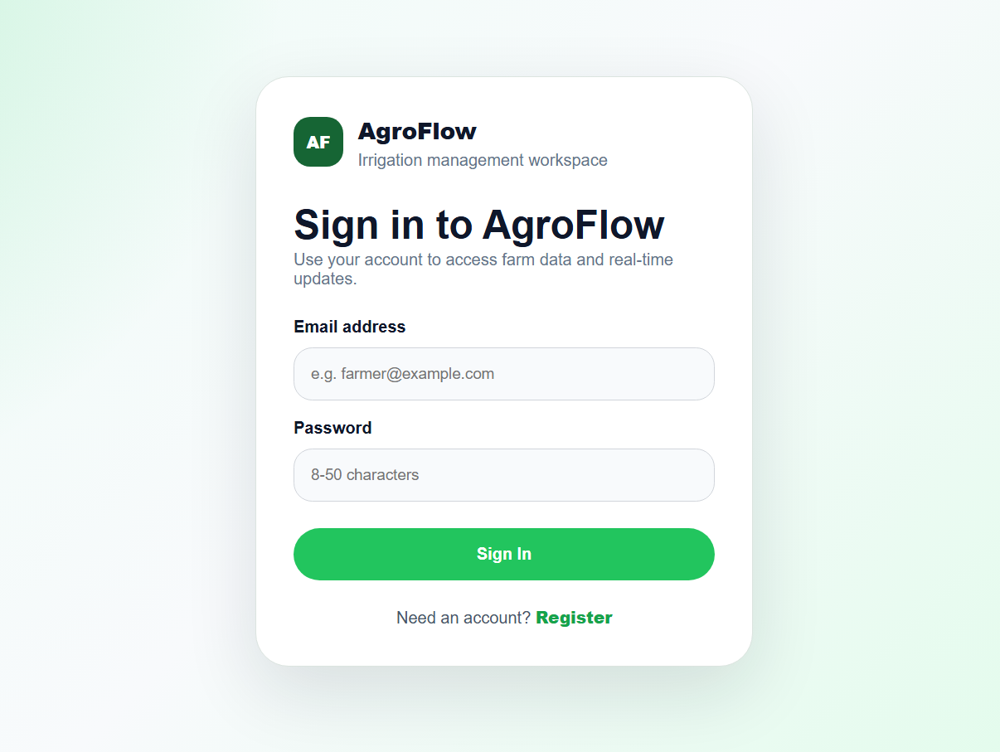
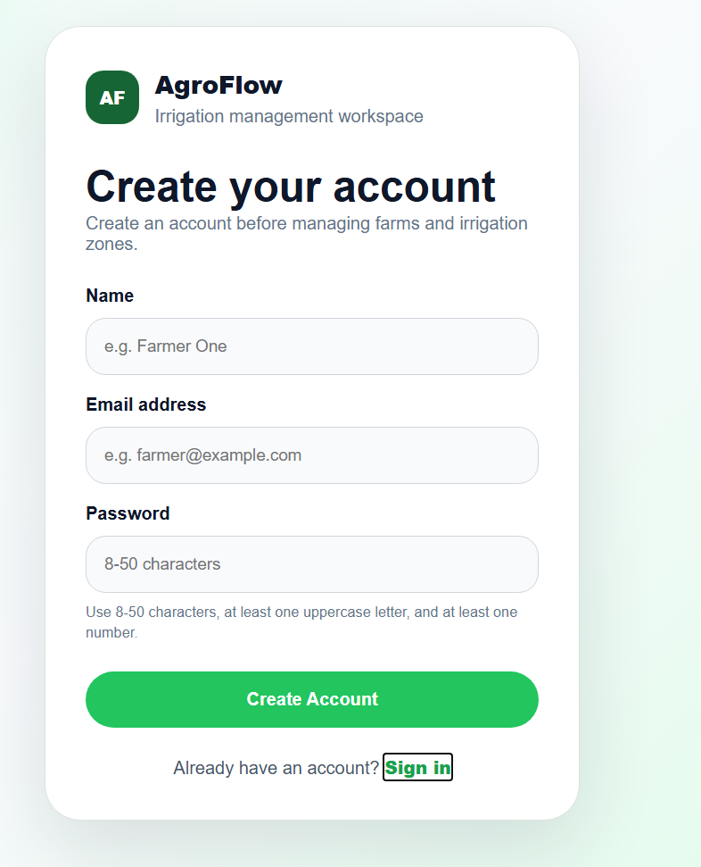
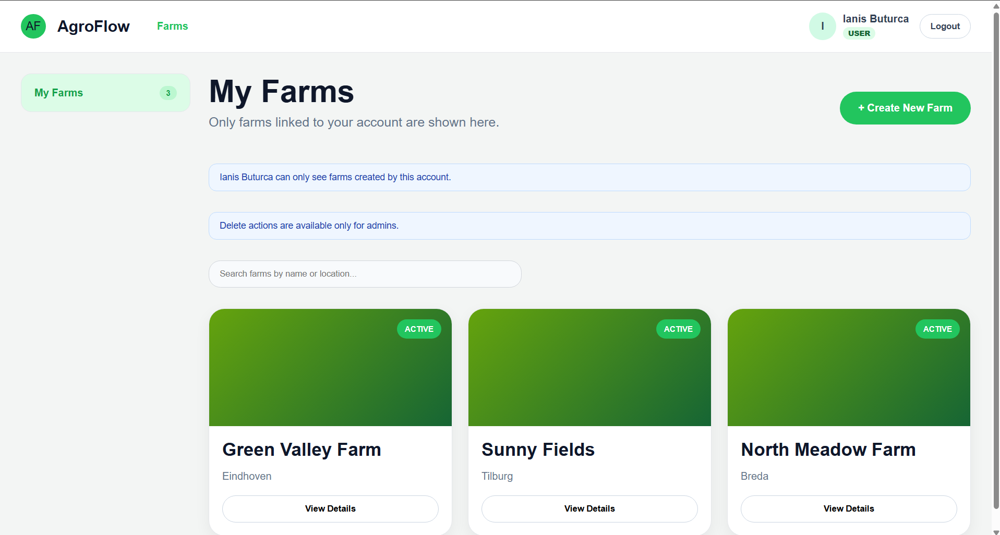
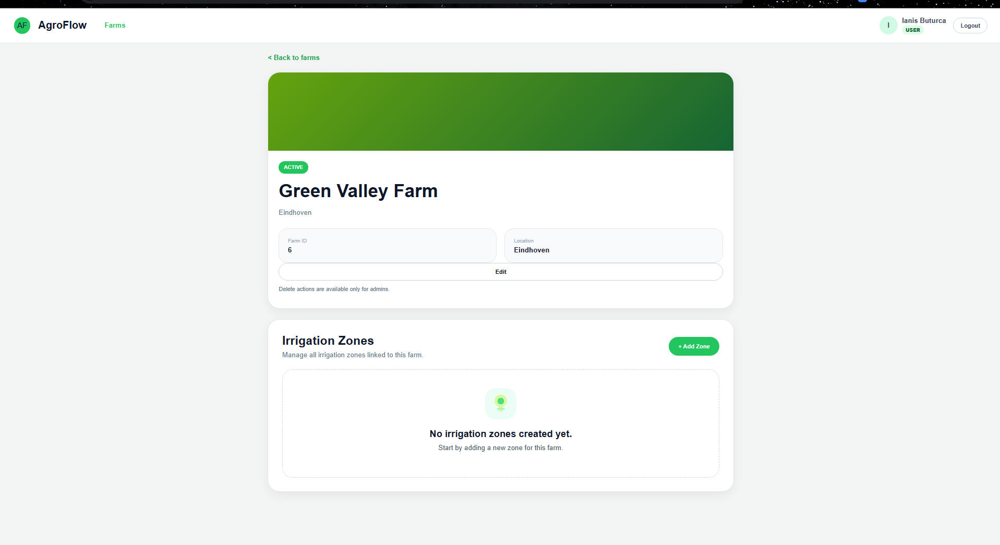
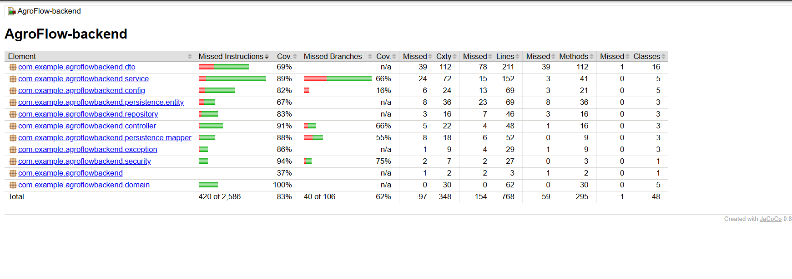

# AgroFlow

**Full-stack farm and irrigation-zone management application**  
Java 21 · Spring Boot · React · PostgreSQL · Docker · WebSockets

AgroFlow is a full-stack application for organizing farms and their irrigation zones. It combines a React interface with a Spring Boot REST API, role-based access control, persistent PostgreSQL storage, and real-time farm-change notifications using STOMP over WebSockets.

This project was developed as an individual full-stack development project and is presented here as a portfolio application.

## Features

- **Authentication:** register, sign in, sign out, and access protected pages.
- **Role-based authorization:** standard users can manage their farms; administrator privileges are required for farm deletion.
- **Farm management:** create, view, and update farms, with access restrictions between users.
- **Irrigation zones:** add zones to a farm with a name, crop type, area size, and moisture threshold; view the zones associated with a farm.
- **Real-time updates:** backend farm events are published to a WebSocket topic and consumed by the frontend.
- **Validation:** request validation on the backend and feedback in the frontend.

> **Scope:** AgroFlow currently manages farm and irrigation-zone *records*. It is not connected to physical irrigation equipment or live moisture sensors.

## Tech stack

| Area | Technologies |
| --- | --- |
| Frontend | React, JavaScript, Vite, CSS, React Router, STOMP.js |
| Backend | Java 21, Spring Boot, Spring Security, Spring Data JPA, REST APIs |
| Database | PostgreSQL; H2 in-memory database for integration tests |
| Real-time | WebSocket + STOMP |
| Infrastructure | Docker, Docker Compose, Gradle |
| Testing and analysis | JUnit 5, Mockito, Spring MockMvc, JaCoCo, SonarQube integration |

## Architecture

The backend uses a layered structure:

```text
React / Vite frontend
    |
    | HTTP / REST (Bearer authentication)
    v
Spring Boot controllers -> application services -> domain/repository layer
                                                    |
                                              JPA entities + mappers
                                                    |
                                                PostgreSQL

Spring Boot notification service -- STOMP / WebSocket --> React subscribers
```

Controllers handle HTTP and DTO validation. Services implement application operations; repositories and mappers separate the domain model from JPA persistence. See [`AgroFlow-backend/docs/architecture-and-domain-models.md`](AgroFlow-backend/docs/architecture-and-domain-models.md) for further design notes.

### Authentication and security

- Passwords are hashed with BCrypt.
- Protected API calls use a Bearer token.
- Registration creates an account with the `USER` role.
- A configured `ADMIN` account supports administrator-only operations.
- Tokens are currently stored **in backend memory** and become invalid after a backend restart. This is a prototype limitation, not a production-ready session-management solution.

## Run locally with Docker

### Requirements

- Docker Desktop with Docker Compose
- Free local ports **5173**, **8080**, and **5433**

### 1. Configure the environment

From the project root, create `.env` from the example:

```powershell
Copy-Item .env.example .env
```

Open `.env` and replace the placeholder values with your own local database and administrator credentials. **Do not commit `.env`.**

### 2. Start the application

```powershell
docker compose up -d --build
```

Open the frontend at **http://localhost:5173**. The backend API is exposed at **http://localhost:8080**. In this portfolio Docker setup PostgreSQL is mapped to host port **5433** to avoid conflicts with another PostgreSQL installation.

You can register a regular user through the frontend. The administrator credentials come from your local `.env` configuration.

### 3. Stop the application

```powershell
docker compose down
```

This stops the application containers without requesting volume deletion. Avoid `docker compose down -v` if you want to preserve the local database volume.

## Testing

The backend includes unit, controller, security, and API integration tests. API integration tests use the `test` Spring profile with an **H2 in-memory database**, separate from the local PostgreSQL instance.

From the backend folder:

```powershell
cd AgroFlow-backend
.\gradlew.bat clean test jacocoTestReport
```

Generated reports:

- Test results: `AgroFlow-backend/build/reports/tests/test/index.html`
- JaCoCo HTML: `AgroFlow-backend/build/reports/jacoco/test/html/index.html`
- JaCoCo XML: `AgroFlow-backend/build/reports/jacoco/test/jacocoTestReport.xml`

### Latest local test run

| Metric | Result |
| --- | ---: |
| Automated backend tests | **62 passed** |
| JaCoCo instruction coverage | **83%** |
| JaCoCo branch coverage | **62%** |
| JaCoCo line coverage | **80%** |

These are results from a local run, **not** a GitHub Actions status badge. JaCoCo and SonarQube can report different coverage metrics or apply different exclusions.

## API overview

| Method | Route | Purpose |
| --- | --- | --- |
| POST | `/auth/register` | Register a user |
| POST | `/auth/login` | Sign in |
| POST | `/auth/logout` | Sign out |
| GET | `/auth/me` | Retrieve the signed-in account |
| GET / POST | `/farms` | List/create farms |
| GET / PUT / DELETE | `/farms/{id}` | View/update/delete a farm (deletion requires ADMIN) |
| GET / POST | `/farms/{farmId}/irrigation-zones` | List/create irrigation zones |
| WebSocket | `/ws` | STOMP connection endpoint |
| STOMP topic | `/topic/farms` | Farm-created/updated/deleted notifications |

Authorization is enforced server-side; the frontend additionally hides or restricts controls where appropriate.

## Screenshots

### Authentication

| Login | Registration |
| --- | --- |
|  |  |

### Farm Dashboard

Overview of registered farms and farm management actions.



### Farm Details & Irrigation Zones

Farm information, irrigation zones, crop types and moisture thresholds.



### Testing & Code Coverage

62 automated tests passing, with 83% instruction coverage and 62% branch coverage measured using JaCoCo.



## Project structure

```text
AgroFlow/
├── AgroFlow-backend/          # Spring Boot API, domain, persistence, tests
│   └── docs/                 # Architecture and UX notes
├── agroflow-frontend/        # React + Vite client
├── docker-compose.yml        # Local application services
├── .env.example              # Example configuration (no real secrets)
└── README.md                 # Project overview
```

## Known limitations and next steps

- Replace in-memory authentication tokens with a production-suitable approach.
- Improve responsiveness and accessibility across more screen sizes.
- Review placeholder UI elements and ensure they are clearly labeled or removed.
- Add automated browser-based UI tests and GitHub Actions CI if the project is published.
- Extend irrigation functionality beyond storing zone settings; live sensors and automatic irrigation are not implemented.

## Project status

**Portfolio prototype / local development.** The application runs locally with Docker Compose. Public source release is subject to confirmation that the university project may be shared externally.

## Author

Developed as an individual full-stack project by **Ianis**.
